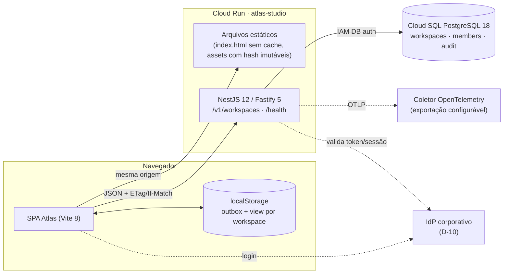
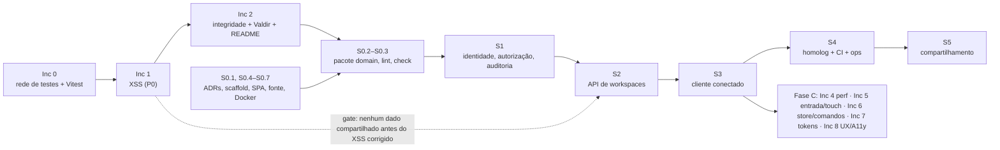

> **Superado por [docs/prd.md](../prd.md)** em 2026-11-14. Mantido como registro histórico do Atlas.

# PEP Atlas Studio — Plano de evolução com servidor web

> **For agentic workers:** REQUIRED SUB-SKILL: Use drc-superpowers:subagent-driven-development (recommended) or
> drc-superpowers:executing-plans to implement this plan task-by-task. Steps use checkbox (`- [ ]`) syntax for tracking.

**Goal:** levar o Atlas Studio de um HTML autocontido com `localStorage` para um produto com servidor web, com
persistência compartilhada, identidade corporativa e auditoria, sem perder o modo portátil durante a transição, e
corrigir antes os achados que um servidor amplificaria (XSS armazenado, integridade e dados pessoais no repositório).

**Architecture:** monorepo npm com três pacotes: o web na raiz (Vite 8, sem framework de UI), `packages/domain` (o
`src/domain` atual, puro, compartilhado) e `server/` (NestJS 12 sobre Fastify 5, Node.js 26 LTS). O servidor entrega a
SPA e a API `/v1/workspaces` na mesma origem e guarda cada mapa como documento JSONB versionado no Cloud SQL
PostgreSQL 18, com travamento otimista (ETag/If-Match → 409).

**Tech Stack:** TypeScript 5.9 strict (web), TypeScript 6 (servidor, exigido pelo CLI do Nest 12), Vite 8, Vitest ≥ 4.1,
NestJS 12 (ESM), Fastify 5, TypeORM, PostgreSQL 18, OpenTelemetry, Docker, Cloud Run.

**Spec:** assessment técnico de 2026-11-13 (entregue na conversa, sem arquivo no repositório) e as decisões D-1 a D-8
registradas na seção 1.

**Status:** proposta aguardando o OK do Tech Lead. Nenhuma task começa antes do OK (Regra 9 e "Use Plan Mode for
architectural refactoring", do `CLAUDE.md` do repositório).

**evidence: unavailable:** o repositório não está no catálogo do drc-rag. Toda evidência deste plano saiu de leitura do
checkout e de execução local, no build do HEAD copiado para `/tmp`.

> **Local do arquivo:** a skill `writing-plans` recomenda `docs/superpowers/plans/AAAA-MM-DD-<feature>.md`. Este plano
> fica em `docs/plan.md` porque o dev pediu esse caminho. Cada incremento da Fase C ganha um plano detalhado próprio no
> caminho padrão da skill quando começar.

---

## Global Constraints

- **Stack e versão:** `Node 26 LTS (>=26.13.0 <27) / NestJS 12 / Fastify 5` no servidor. No web, TypeScript 5.9
  strict (`verbatimModuleSyntax`, `isolatedModules`, `noUnused*`), Vite 8, sem framework de UI.
- **Guardrails que valem para toda task:** `clean-code-typescript` + `nestjs-security` (servidor); `drc-guardrails-codigo`,
  `drc-guardrails-api` e `drc-guardrails-banco` conforme o que a task toca; `drc-guardrails-infra` e
  `drc-guardrails-negocio` no S4.
- **Git:** branch `<tipo>/<TICKET>` a partir de `main` atualizado (o repositório usa `main`, não `master`). Commits no
  formato `tipo(TICKET): descrição`, em pt-BR e sem trailer `Co-Authored-By`. Nunca push para `main` ou `homolog`. Hoje
  não existe remote (D-11).
- **Dados:** seed, fixtures e exemplos só com persona e massa sintéticas. Nenhum dado de paciente real em código, teste,
  log, commit ou PR.
- **Gate de conclusão:** `npm run check` (typecheck + lint + Vitest de todos os pacotes) e `npm run test:e2e` verdes.
- **Jira (se houver ticket):** transições só via `jira-acli`. Nunca mover para `DESENVOLVIMENTO IA`.
- **Comentários:** a política do `AGENTS.md` vale para todo código novo ou tocado. O padrão é não comentar; comentário
  só para explicar o PORQUÊ (decisão arquitetural não óbvia, restrição externa, segurança). Sem JSDoc de eco, sem
  código comentado e sem TODO no código.
- **Dependências:** cada lib nova passa por Context7 (versão e API atual) e por `npm audit`, sempre com lockfile
  commitado. O CI usa `npm ci`. Fora as libs nomeadas neste plano, nenhuma entra sem aprovação.
- **Comportamento:** preservar o comportamento atual, salvo quando a task diz explicitamente o que muda.
- **Governança:** `AGENTS.md` e `CLAUDE.md` não mudam sem autorização explícita.

## Review Focus

Entradas e falhas que a spec implica, que nenhum teste de task cobre por padrão e que mais devem afetar quem usa. Cada
linha tem um teste na task dona, citado entre parênteses.

1. **Mesmo mapa aberto em duas abas ou por duas pessoas:** a segunda gravação recebe 409, o usuário escolhe o que fazer
   e nada é sobrescrito em silêncio nem regravado em loop (S2.3 `rejects stale If-Match with 409`; S3.4 e2e
   `conflict-two-tabs`).
2. **Câmera, foco e aba gravados dentro do documento:** hoje `persistViewNow()` grava `ws.view` no próprio mapa
   (`src/core/persistence.ts:79-96`). Num documento compartilhado, mover a câmera mudaria a versão e geraria 409 falso
   para os outros. O estado de visão passa a ser local, por usuário (S2.2 `strips view before storing`; S3.2
   `view changes never schedule a server save`).
3. **Sessão expirada no meio da edição:** o 401 no save mantém as alterações no outbox local, pede novo login e
   sincroniza depois, sem perda (S3.3 `keeps outbox on 401 and resyncs after login`).
4. **Campos desconhecidos e backups antigos:** documentos da v1.5, de `pep-discovery-atlas-v1` e com campos extras
   (`[extra: string]: unknown` em `src/domain/types.ts`) passam pelo servidor sem perder campo (S2.2
   `round-trips unknown fields`; S2.2 `accepts every ACCEPTED_SCHEMAS input`).
5. **Documento grande ou rede ruim (cold start, offline):** o 413 gera mensagem clara; offline e 5xx viram "pendente"
   com backoff, e o `beforeunload` avisa quando há alteração não sincronizada (S2.3 `rejects body over
   WORKSPACE_MAX_BYTES with 413`; S3.3 `backs off on network failure`).

---

## 1. Decisões registradas (2026-11-13)

| #   | Decisão do dev                    | O que vira neste plano                                                                                                                                                                                                                                 |
|-----|-----------------------------------|--------------------------------------------------------------------------------------------------------------------------------------------------------------------------------------------------------------------------------------------------------|
| D-1 | Remover os dados do "Valdir"      | Inc 2: seed e fixtures com persona sintética, mantendo os ids estruturais; apagar `atlas-valdir-inicial-v1.5.json` e os 4 PNGs de preview; cabeçalho genérico. A reescrita do histórico do git é decisão separada (D-14).                                |
| D-2 | Hierarquia: seguir a recomendação | Os campos de pai (`chapter.journeyId`, `scene.chapter`, `event.sceneId`) viram a fonte única. As setas `contém` passam a ser derivadas, mas continuam no export por compatibilidade. Correção pontual no Inc 2, refatoração completa no Inc 6.          |
| D-3 | Roda e trackpad = pan; Ctrl/⌘ + roda ou pinça = zoom | Inc 5: zoom proporcional a `deltaY`, ancorado no cursor.                                                                                                                                                                                            |
| D-4 | Dev deps (Vitest, lint) e CI      | Vitest entra no Inc 0 para proteger o Inc 1; lint, formatter e `npm run check` no S0; pipeline de CI no S4 (a plataforma depende de D-11).                                                                                                              |
| D-5 | Metas de performance              | Inc 4, no mapa sintético de 2,1k nós: clique ≤ 50 ms, tecla ≤ 16 ms, carga com posições salvas ≤ 2 s, sem regressão no seed.                                                                                                                             |
| D-6 | Touch e tablet                    | Inc 5: Pointer Events com `touch-action`, pinça, portas visíveis sem hover.                                                                                                                                                                          |
| D-7 | Sair do Google Fonts              | S0.6: JetBrains Mono (licença OFL 1.1) auto-hospedada. Sem isso a CSP precisaria liberar domínios do Google.                                                                                                                                             |
| D-8 | Servidor web: Node.js ou Bun      | ADR-001 recomenda Node.js 26 LTS (seção 2). A trilha do servidor (S0–S5) começa em paralelo com os pré-requisitos (seção 7).                                                                                                                             |
| D-9 | Test runner do servidor (2026-11-13) | Vitest nos três pacotes (web, domínio e servidor). |
| D-10 | Autenticação (2026-11-13)        | Opção A: IAP direto no Cloud Run; o app valida o JWT do IAP (algoritmo fixo, `iss`, `aud`, `exp`) e identifica o usuário pelo `sub`. O IdP (Google ou Entra ID via Workforce Identity Federation) é configuração de infra. A Opção B sai do plano. |
| D-14 | Reescrita do histórico (2026-11-13) | Autorizada: Task 2.6, com backup em bundle fora do repositório. |
| D-18 | Seed (2026-11-13)                | O canvas nasce limpo: sem mapa de exemplo na primeira abertura. A massa de teste vira sintética, escrita do zero (Task 2.4). |

---

## 2. ADR-001 — Runtime do servidor: Node.js 26 LTS

**Status:** Proposta. **Data:** 2026-11-13. **Decisor:** Tech Lead.

### Contexto

O Atlas passa a ter servidor: ele entrega a SPA, guarda os mapas em banco, autentica pela identidade corporativa e
audita os acessos. O padrão da empresa para serviço novo é NestJS com Fastify no Cloud Run, PostgreSQL, OpenTelemetry
com exportação configurável (ADR-0011) e o scaffold `/drc-cmd-arch-criar-microservico-nestjs`. O mapa de arquitetura
(`drc-mapa-arquitetura`) lista NestJS e Python no Cloud Run e não menciona Bun.

A carga do servidor é pequena: CRUD de documentos JSON e arquivos estáticos, num app interno. Os gargalos medidos no
assessment estão todos no navegador: render total via `innerHTML`, `layersLayout` O(S·E²), `first.includes` O(E·N),
`JSON.stringify` do workspace inteiro a cada `pointerdown`. O runtime do servidor não muda nenhum deles.

### Opções

| Critério                         | Node.js 26 LTS ("Lithium")                                                                                                     | Bun 1.4.4                                                                                                                                               |
|----------------------------------|--------------------------------------------------------------------------------------------------------------------------------|---------------------------------------------------------------------------------------------------------------------------------------------------------|
| Ciclo de suporte                 | LTS ativa desde 2026-10-28 (26.13.0), manutenção até 2029-04-30. A partir do 27, uma major por ano e toda versão vira LTS.       | Release mais recente: 2026-10-22. Não encontrei política de LTS publicada.                                                                               |
| Padrão da empresa                | NestJS + Fastify no Cloud Run, com scaffold e Golden Path.                                                                     | Fora do padrão documentado. Adotar exigiria ADR de exceção.                                                                                              |
| NestJS 12                        | Requisitos publicados em versão do Node: rodar exige ≥ 20.19 ou ≥ 22.12; o CLI, ≥ 22.22.3, ≥ 24.15 ou ≥ 26. Pacotes ESM-only.       | Os requisitos publicados do Nest 12 não falam em Bun. Rodaria pela camada de compatibilidade com Node, sem garantia do framework.                          |
| OpenTelemetry (ADR-0011)         | SDK Node com auto-instrumentação de primeira classe.                                                                           | Usa o mesmo SDK pela camada de compatibilidade. `Bun.serve` e o `fetch` nativo não são auto-instrumentados, e os guias desligam a instrumentação de `fs`.    |
| Governança                       | Projeto da OpenJS Foundation.                                                                                                  | MIT, código aberto no GitHub (`oven-sh/bun`), mas propriedade da Anthropic desde dez/2025, sem fundação nem órgão de governança separado.                  |
| Desempenho                       | Suficiente para a carga prevista.                                                                                              | Partida e throughput melhores nos benchmarks do fornecedor, que não medi aqui. A vantagem real seria o cold start no Cloud Run com `min-instances=0`.     |
| Ferramentas                      | npm, lockfile e `npm ci`, como o resto da empresa.                                                                             | Gerenciador de pacotes, bundler e test runner embutidos. Misturar com npm duplicaria o lockfile, contra `drc-guardrails-decisao`.                          |
| Time                             | Conhecimento existente: NestJS, Jest e Vitest.                                                                                 | Curva nova sem ganho mensurável neste produto.                                                                                                            |

### Decisão

**Node.js 26 LTS**, fixado em `engines.node: ">=26.13.0 <27"` e num `.node-version` com `26`. O Node local é v26.12.0
(conferido), anterior à promoção para LTS: atualize para 26.13 ou mais novo antes do S0.

### Consequências

- O servidor segue o Golden Path da empresa (NestJS + Fastify, OTel, Cloud Run) e pode usar o scaffold oficial.
- A imagem base do Dockerfile é `node:26-*`, fixada por digest SHA.
- Cold start com `min-instances=0` será medido no S4. A primeira resposta, se ele incomodar, é `min-instances=1`, não
  trocar o runtime.

### Quando revisitar

- O Bun entra no Golden Path da empresa.
- O cold start, medido no S4, estoura um SLO acordado e `min-instances=1` é recusado por custo.
- O servidor deixa de ser NestJS (por exemplo, vira um servidor estático mínimo).

> **Nota de transparência:** a Anthropic, empresa que desenvolve o modelo que redigiu este plano, é dona do Bun desde
> dez/2025. A recomendação vai no sentido contrário ao Bun e se apoia nos critérios da tabela, não nessa relação.

---

## 3. ADR-002 — Framework: NestJS 12 sobre Fastify 5

**Status:** Proposta.

- **Decisão:** NestJS 12 com `FastifyAdapter` (Fastify 5), projeto ESM (`"type": "module"`, `module`/`moduleResolution`
  `nodenext`). Estrutura Controller → Service → Repository → Entity/DTO. DTOs com `class-validator`, Swagger fora de
  produção, guard global com `@Public()` explícito, `GlobalExceptionFilter`, TypeORM.
- **Alternativa considerada:** Fastify puro, mais leve e alinhado ao "evitar abstrações desnecessárias" do
  `AGENTS.md`. Descartada porque `drc-guardrails-arquitetura` exige NestJS em serviço novo; usar Fastify puro pediria
  exceção sem ganho que a justifique.
- **Test runner do servidor:** o template ESM do Nest 12 usa Vitest por padrão, e o web precisa de Vitest ≥ 4.1 por
  causa do Vite 8. Recomendo Vitest nos três pacotes. O guardrail cita Jest; com Jest, o Nest 12 exige Node ≥ 24.9 para
  carregar os pacotes ESM, o que o Node 26 atende. Decisão pendente: D-9.
- **Verificação obrigatória no S0:** confirmar no Context7 as versões e APIs de `@nestjs/*`, `@nestjs/platform-fastify`,
  `@fastify/helmet`, `@fastify/static` (ou `@nestjs/serve-static`), `typeorm`, `pg`, `@opentelemetry/sdk-node` e
  `nestjs-pino`/`pino` antes de instalar (Regra 21).

---

## 4. ADR-003 — Persistência: documento JSONB versionado com travamento otimista

**Status:** Proposta.

### Decisão

- **Banco:** Cloud SQL PostgreSQL 18, padrão da empresa para serviço novo. A instância e o tier do serviço, que definem
  HA `REGIONAL` e a cadência de restore, ficam em D-12.
- **Modelo:** cada mapa é uma linha de `workspaces` com o documento inteiro em `document jsonb` e uma coluna
  `version integer`. O cliente já opera sobre o documento inteiro (undo por snapshot, export, import), e normalizar
  seria uma reescrita sem evidência de necessidade.
- **Concorrência:** travamento otimista por documento. `GET` devolve `ETag: "<version>"`; `PUT` exige `If-Match`
  (428 se faltar) e grava com `UPDATE … WHERE id = $1 AND version = $2 RETURNING version`. Se nenhuma linha mudar, a
  resposta é 409 com a versão atual.
- **Fora do documento:** `view` (câmera, foco, aba, modo do caderno) é estado por usuário e fica no `localStorage`, numa
  chave por workspace. O servidor remove `view` antes de gravar.
- **Sem coedição em tempo real** nesta fase: duas pessoas editando o mesmo mapa ao mesmo tempo recebem conflito
  explícito. Edição granular (patches por comando, CRDT) fica fora de escopo; o Inc 6 prepara o terreno com comandos.

### Esquema inicial (migrations TypeORM com `up` e `down`)

| Tabela              | Colunas                                                                                                                                                                                  | Observação                                                                                         |
|---------------------|------------------------------------------------------------------------------------------------------------------------------------------------------------------------------------------|----------------------------------------------------------------------------------------------------|
| `users`             | `id uuid pk default gen_random_uuid()`, `idp_subject text unique not null`, `display_name text not null`, `created_at timestamptz`                                                         | Sem e-mail nem CPF: o `idp_subject` basta para autorizar. `display_name` é PII mínima.               |
| `workspaces`        | `id uuid pk`, `title text not null`, `document jsonb not null`, `schema text not null`, `version integer not null default 1`, `created_by uuid fk`, `updated_by uuid fk`, `created_at timestamptz`, `updated_at timestamptz`, `deleted_at timestamptz null` | Soft delete. Timestamps em UTC (`timezone: 'Z'` na conexão).                                         |
| `workspace_members` | `workspace_id uuid fk`, `user_id uuid fk`, `role text check (role in ('owner','editor','viewer'))`, PK `(workspace_id, user_id)`                                                          | Quem cria vira `owner`.                                                                             |
| `audit_events`      | `id uuid pk`, `occurred_at timestamptz`, `actor_user_id uuid`, `workspace_id uuid null`, `action text`, `outcome text`, `correlation_id text`                                              | Nunca guarda conteúdo do documento.                                                                  |
| `idempotency_keys`  | `key text`, `user_id uuid`, `request_hash text`, `response_status int`, `response_body jsonb`, `created_at timestamptz`, PK `(user_id, key)`                                               | Retenção de 24 h.                                                                                    |

Toda escrita que toca `workspaces` e `audit_events` roda numa transação só (`drc-guardrails-banco`). O conteúdo dos
mapas é material de oficina com persona sintética. Mesmo assim, campos de texto livre (`notes`, `story`, `pain`, caderno)
podem receber dado sensível por engano. Por isso: o conteúdo nunca vai para log, o acesso é auditado, a criptografia
em repouso fica no nível do Cloud SQL, e a classificação e a retenção são definidas com o DPO (D-13).

---

## 5. Arquitetura alvo



### 5.1 Estrutura do repositório

```
/                         web (raiz atual, continua aqui para não mover src/ nem quebrar o histórico)
├── package.json          "workspaces": ["packages/*", "server"]; scripts check, test, test:e2e, build, build:portable
├── src/                  SPA (app, canvas, core, io, ui) importando @pep-atlas/domain
├── public/fonts/         JetBrains Mono woff2 + OFL.txt
├── packages/domain/      @pep-atlas/domain (private): o src/domain atual + validate.ts
├── server/               NestJS 12 ESM
│   ├── src/Controller/Workspace/  src/Service/Workspace/  src/Repository/Workspace/
│   ├── src/Model/  src/Infrastructure/{Auth,Http,Observability,Persistence}/
│   ├── src/migrations/
│   └── test/
├── tests/e2e/            roteiros Playwright, rodando contra file:// (portátil) e http:// (servidor)
├── Dockerfile  .dockerignore  docker-compose.yml (Postgres 18 local)
└── docs/plan.md  docs/adr/
```

O pacote de domínio se chama `@pep-atlas/domain`, é `private: true`, nunca é publicado e resolve como workspace npm.
Ele não usa o escopo `@drconsulta`, que exigiria `.npmrc` apontando para o registry interno.

**Compartilhar o domínio entre Bundler e nodenext:** hoje o domínio importa sem extensão (`moduleResolution: Bundler`),
e o servidor ESM `nodenext` exige extensão. Por isso:

- os imports relativos de `packages/domain` passam a usar `.ts`, com `allowImportingTsExtensions` e
  `rewriteRelativeImportExtensions` (TS ≥ 5.7);
- o pacote compila para `dist/` com `tsc`;
- o servidor consome `dist/`;
- o web resolve o fonte pela condição de export `atlas-source` (`resolve.conditions` no Vite, `customConditions` no
  tsconfig) e mantém o HMR.

### 5.2 Contrato da API (`/v1`)

| Método e rota                         | Papel mínimo       | Sucesso                                         | Erros                                     |
|---------------------------------------|--------------------|-------------------------------------------------|-------------------------------------------|
| `GET /health`                         | público            | 200 `{ status: "ok" }` (liveness)               | —                                         |
| `GET /health/ready`                   | público            | 200 se o banco responde                         | 503                                       |
| `GET /v1/workspaces?limit&offset`     | autenticado        | 200 `{ data: [{ id, title, role, updatedAt, version }], total, limit, offset }`; `limit` default 50, máx. 100 | 400, 401 |
| `POST /v1/workspaces`                 | autenticado        | 201 + `ETag` + `Location`; corpo `{ title, document? }` (vazio, template ou import); exige `Idempotency-Key` | 400, 401, 413, 422, 428 |
| `GET /v1/workspaces/:id`              | viewer             | 200 `{ id, title, role, version, document }` + `ETag` | 401, 404                            |
| `PUT /v1/workspaces/:id`              | editor             | 200 `{ version, updatedAt }` + novo `ETag`; corpo `{ title, document }`; exige `If-Match` | 401, 403, 404, 409 `{ currentVersion }`, 413, 422 `{ issues }`, 428 |
| `DELETE /v1/workspaces/:id`           | owner              | 204 (soft delete)                               | 401, 403, 404                             |
| `GET/PUT /v1/workspaces/:id/members`  | owner              | S5                                              | 401, 403, 404, 422                        |

Regras de todas as rotas:

- **Formato de erro:** `{ statusCode, message, timestamp, path }`, sem PII nem trecho do documento.
- **Sem acesso:** quem não é membro recebe 404, não 403, para não confirmar que o id existe. Membro sem o papel exigido
  recebe 403.
- **Tamanho:** `WORKSPACE_MAX_BYTES` vale como `bodyLimit` do Fastify, cujo padrão é 1 MiB. O valor inicial é 8 MiB, a
  calibrar no S2 com o tamanho real do JSON do mapa sintético de 2,1k nós.
- **Validação em duas camadas:** o DTO valida o envelope; `parseWorkspace` (do domínio) valida o documento no Service.
  Documento inválido recebe 422 com `issues: [{ path, code }]`.
- **JSON:** o parser seguro do Fastify fica no padrão, com `__proto__` e `constructor` rejeitados (confirmar
  `onProtoPoisoning`/`onConstructorPoisoning` no Context7).
- **CSRF:** toda rota mutável exige o header `X-Atlas-Client: 1` e `Sec-Fetch-Site: same-origin` (ou `Origin` igual ao
  host). O navegador autentica por cookie nas duas opções de D-10, então CSRF se aplica em ambas.
- **Swagger:** habilitado fora de produção.

### 5.3 Segurança na borda

- **CSP** (via `@fastify/helmet`):
  - `default-src 'self'; script-src 'self'; object-src 'none'; base-uri 'none'; frame-ancestors 'none';
    font-src 'self'; connect-src 'self'; img-src 'self' data: blob: https:; style-src 'self' 'unsafe-inline'`.
  - `script-src 'self'` é seguro: o código não tem handler inline nem `eval` (conferido com grep em `src/` e
    `index.html`).
  - `style-src 'unsafe-inline'` continua por enquanto, porque o render escreve `style="left:…"` via `innerHTML` (35
    atribuições). Sai no Inc 7, quando posição e tamanho passarem a ir pelo CSSOM.
  - `img-src https:` preserva imagens externas em notas Markdown.
- **Build:** o build do servidor não usa `vite-plugin-singlefile`, porque JS inline exigiria nonce ou hash na CSP. O
  singlefile continua como `build:portable`.
- **Outros headers:** HSTS (o Cloud Run já serve HTTPS), `Referrer-Policy: same-origin`, `X-Content-Type-Options:
  nosniff`. Respostas da API sempre em `application/json`.
- **Logs:** pino estruturado com `correlationId` em toda linha, propagando ou gerando `X-Correlation-ID`. O log nunca
  leva corpo de request, documento, nome nem e-mail.

### 5.4 Cliente conectado

- **Porta de armazenamento:** `WorkspaceStore`, com duas implementações escolhidas no build por
  `import.meta.env.VITE_STORAGE_MODE` (`"local"` | `"server"`):
  - `LocalWorkspaceStore`: o comportamento atual, usado no build portátil;
  - `HttpWorkspaceStore`: o servidor.
- **`persist()` como fachada:** continua síncrona e com a mesma assinatura, porque são 33 chamadas em 11 arquivos.
  Ela grava o outbox local (`{ workspaceId, baseVersion, document, dirty }`) e chama `SyncScheduler.markDirty()`. O
  envio ao servidor é assíncrono:
  - debounce de 1.000 ms, com espera máxima de 5.000 ms;
  - backoff de 1, 2, 4 e 8 s, com teto de 30 s, para rede e 5xx;
  - nunca repete 4xx; o 401 espera novo login.
- **Estado de visão:** `persistViewNow()` grava só no `localStorage` (`pep-atlas-view:<workspaceId>`) e nunca agenda
  save no servidor.
- **Boot:** `startApp()` vira assíncrono e mostra estado de carregamento. 401 leva ao login, 404 leva ao seletor de
  mapas.
- **Conflito (409):** um diálogo oferece duas saídas, sem merge automático:
  - "Carregar a versão do servidor": exporta antes o JSON local e limpa o undo;
  - "Manter a minha e sobrescrever": um novo `PUT` com `If-Match` igual à versão do servidor, como ação explícita.
- **Migração do `localStorage`:** se existir dado na chave `pep-atlas-studio-v4` e ele não tiver sido migrado, um
  banner oferece "Enviar meu mapa deste navegador para o servidor". O envio é um `POST` com `Idempotency-Key` guardada
  em `pep-atlas-migration-key`. A cópia local fica, marcada com `migratedTo`.

---

## 6. Pendências de decisão (bloqueiam as tasks indicadas)

| #    | Pendência                                                                                                       | Recomendação                                                                                                                                                                                                                                     | Bloqueia               |
|------|-----------------------------------------------------------------------------------------------------------------|--------------------------------------------------------------------------------------------------------------------------------------------------------------------------------------------------------------------------------------------------|------------------------|
| D-9  | Test runner do servidor: Vitest ou Jest                                                                         | Vitest nos três pacotes: é o padrão do template ESM do Nest 12, e o web já precisa dele.                                                                                                                                                          | S0.3                   |
| D-10 | Autenticação                                                                                                    | Opção A: IAP na frente do Cloud Run, com o app validando o JWT assinado do IAP (algoritmo fixo, `iss`, `aud`, `exp`), se as identidades corporativas já estão no GCP. Opção B: OIDC Authorization Code + PKCE no servidor, com cookie de sessão `HttpOnly; Secure; SameSite=Lax`. Confirmar o IdP com Plataforma/SRE (o uso de Microsoft 365 indica Entra ID, mas não verifiquei). | S1.3, S4               |
| D-11 | Onde o repositório vai morar (hoje sem remote), plataforma de CI e modelo de branches                           | GitHub (conector já configurado), com CI no GitHub Actions ou Cloud Build, conforme o padrão do time; GitFlow da empresa (`develop`/`homolog`/`master`) ou `main` + PR.                                                                             | S4                     |
| D-12 | Instância do Cloud SQL e tier do serviço                                                                        | Declarar o tier no registro do serviço. Ele define HA e a cadência de teste de restore (Tier 1 mensal, Tier 2 trimestral, Tier 3 semestral).                                                                                                      | S4                     |
| D-13 | Classificação dos dados e retenção (DPO)                                                                        | Tratar o conteúdo como interno confidencial e exibir na UI o aviso "Não registre dados de pacientes reais". A retenção de mapas apagados e de `audit_events` é definida pelo DPO.                                                                  | S4                     |
| D-14 | Reescrever o histórico do git para tirar os dados do Valdir                                                      | Fazer antes do primeiro push (D-11), com backup do `.git`. É irreversível, por isso pede confirmação própria.                                                                                                                                     | primeiro push          |
| D-15 | Subir o web para TypeScript 6 junto com o servidor                                                              | Numa task própria depois do S0, com typecheck verde. Até lá, web em 5.9 e servidor em 6.                                                                                                                                                           | —                      |
| D-16 | Histórico de versões no servidor (`workspace_revisions`)                                                         | Guardar as últimas 20 versões de cada mapa. É a rede de segurança para "sobrescrever" num conflito.                                                                                                                                                | S2 (opcional)          |
| D-17 | Quando aposentar o build portátil                                                                               | Manter até o S4 estar estável em homolog e decidir com os usuários da oficina.                                                                                                                                                                    | —                      |

---

## 7. Ordem de execução



- **"Foque já no servidor":** S0.1 e S0.4–S0.7 começam no dia 1, em paralelo com o Inc 0. Mexem em `server/`,
  `docs/adr/`, Docker e fontes, sem conflito com `src/`.
- **S0.2 espera o Inc 2:** mover `src/domain` antes disso geraria conflito com o `validate.ts` do Inc 1 e com
  `model.ts` do Inc 2.
- **O Inc 1 é pré-requisito duro do S2:** com armazenamento compartilhado, o XSS armazenado deixa de atingir só quem
  importa o arquivo e passa a atingir todo membro que abrir o mapa.
- **Ambiente compartilhado (S4):** exige Inc 1, Inc 2, D-10, D-12 e D-13 resolvidos.
- **Fase C:** cada incremento ganha plano detalhado próprio quando começar. Inc 4 e Inc 5 podem rodar em paralelo com
  S4 e S5.

---

## 8. Fase A — Pré-requisitos

### Inc 0 — Rede de testes confiável e Vitest

Objetivo: a suíte e2e falha quando deve, roda contra arquivo ou URL, e o domínio ganha testes unitários.

#### Task 0.1: Roteiros sem dependência de `legacy/` e sem erro engolido

**Files:**

- Modify: `tests/e2e/smoke.mjs`, `tests/e2e/zoombtn.mjs` (tirar a comparação com
  `legacy/PEP_Atlas_Studio_v1.5.html`, apagado no commit "clean", e manter só as verificações do build)
- Modify: `tests/e2e/timeline.mjs:44`, `tests/e2e/grammar.mjs:86`, `tests/e2e/notes.mjs:92` (trocar
  `.catch(() => {})` por falha explícita com o nome da verificação)
- Modify: `tests/e2e/focus.mjs`, `es.mjs`, `inline.mjs`, `promote.mjs`, `quick.mjs`, `tl-scene.mjs`, `triple.mjs` (os 7
  roteiros que hoje só navegam: cada um imprime suas verificações e `FAILED` quando alguma é falsa)
- Modify: `tests/e2e/run-all.mjs` (incluir `smoke.mjs`)

- [ ] **Step 1:** Rode `npm run build && (cd tests/e2e && npm test)` no HEAD. Esperado: `zoombtn.mjs` falha por
  `legacy/` ausente, como registrado no assessment.
- [ ] **Step 2:** Ajuste os roteiros. Cada roteiro dos 7 passa a ter pelo menos uma asserção do resultado visível da
  interação que já executa (exemplos: `focus` confere o recorte ativo no breadcrumb; `inline` confere o texto gravado
  no card depois de Enter).
- [ ] **Step 3:** Prova de que a suíte falha: quebre de propósito um seletor em cada um dos 7 roteiros, um por vez, e
  confirme `✗`. Reverta.
- [ ] **Step 4:** `npm run build && (cd tests/e2e && npm test)`. Esperado: `Todos os roteiros passaram`, com 23
  roteiros.
- [ ] **Step 5:** Commit `test([TICKET]): e2e sem legacy e com asserções em todos os roteiros`.

#### Task 0.2: E2E contra file:// ou http://

**Files:** Modify `tests/e2e/*.mjs` (a URL vem de `E2E_BASE_URL`; sem ela, `file://${ROOT}/dist/index.html`)

**Interfaces:** Produces: variável `E2E_BASE_URL`, usada no S0.5 para rodar a suíte contra o servidor.

- [ ] **Step 1:** Centralize a URL num helper `tests/e2e/target.mjs`, que exporta `appUrl(): string`.
- [ ] **Step 2:** Rode `npx vite preview --port 4173` e `E2E_BASE_URL=http://localhost:4173 npm test` em `tests/e2e`.
  Esperado: verde. Atenção: o `localStorage` é por origem, e cada roteiro precisa partir de contexto limpo.
- [ ] **Step 3:** Commit `test([TICKET]): e2e parametrizado por E2E_BASE_URL`.

#### Task 0.3: Vitest no domínio

**Files:**

- Modify: `package.json` (devDependency `vitest` ≥ 4.1, a primeira com suporte a Vite 8; scripts `test` e `check`)
- Create: `vitest.config.ts`, `src/domain/model.test.ts`, `src/domain/grammar.test.ts`

- [ ] **Step 1:** Confirme a versão no Context7 e rode `npm audit` depois de instalar.
- [ ] **Step 2:** Escreva os testes de caracterização do comportamento atual: `graphInit converts
  pep-discovery-atlas-v1 seed`, `upgradeWorkspace keeps extra fields`, `syncMaps derives sceneMappings from edges`,
  `edgeVerdict flags grammar exceptions`.
- [ ] **Step 3:** `npx vitest run`. Esperado: PASS.
- [ ] **Step 4:** Commit `test([TICKET]): Vitest com testes de caracterização do domínio`.

**Gate do Inc 0:** e2e com 23/23 verdes, falhando quando deve; `npm run check` verde.

### Inc 1 — XSS armazenado via JSON (P0)

Objetivo: nenhum valor vindo de import, `localStorage` ou servidor chega ao HTML sem validação de tipo e escape.

#### Task 1.1: `parseWorkspace` no domínio

**Files:** Create `src/domain/validate.ts` e `src/domain/validate.test.ts`

**Interfaces:**

- Produces:
  - `parseWorkspace(input: unknown): ParseResult`
  - `type ParseResult = { ok: true; workspace: Workspace } | { ok: false; issues: ValidationIssue[] }`
  - `interface ValidationIssue { path: string; code: "not_number" | "not_finite" | "not_string" | "unknown_schema" | "invalid_color" | "invalid_key" }`
- Consumes: `graphInit`, `upgradeWorkspace` e `validColor`, de `src/domain/model.ts`; `ACCEPTED_SCHEMAS`, de
  `src/domain/constants.ts`.

- [ ] **Step 1: testes que falham**
  - `rejects non-numeric x in graph.layouts`: com `layouts.all["scene:a"].x = "1px;background:url(javascript:alert(1))"`,
    espera `ok: false` e `issues[0].path === "graph.layouts.all.scene:a.x"`.
  - `rejects Infinity and NaN coordinates`.
  - `rejects w/h non-numeric on notes and frames`.
  - `normalizes invalid edge color to default`: a cor inválida vira o padrão de `validColor`, sem rejeitar o documento.
  - `rejects unknown schema`.
  - `accepts every ACCEPTED_SCHEMAS input`.
  - `round-trips unknown fields`.
- [ ] **Step 2:** `npx vitest run src/domain/validate.test.ts`. Esperado: FAIL, porque a função não existe.
- [ ] **Step 3:** Implemente. Coordenadas e tamanhos passam por `Number.isFinite`; chaves de nó, pelo formato
  `${NodeKind}:${string}`; o resto do documento é preservado.
- [ ] **Step 4:** Esperado: PASS.
- [ ] **Step 5:** Commit `fix([TICKET]): valida tipos do workspace antes do uso`.

#### Task 1.2: Render só interpola número validado ou texto escapado

**Files:** Modify `src/canvas/render.ts`: linhas 201 (`d` e `style` da aresta), 257 (nota), 268 (fundo da moldura),
276 (moldura), 290 (card), 336 e 342 (bandas).

**Interfaces:** Produces: `px(value: number): string` e `svgNumber(value: number): string`, em `src/ui/dom.ts`. Os dois
lançam erro para valor não finito.

- [ ] **Step 1:** Teste e2e que falha, `tests/e2e/xss.mjs`: importe o PoC do assessment com o payload em todas as
  chaves de `graph.layouts`. Espere que nenhum `dialog` dispare e que `window.__xss` continue `undefined`, no import e
  depois do reload.
- [ ] **Step 2:** Rode. Esperado: FAIL, porque o XSS dispara (comportamento confirmado no assessment).
- [ ] **Step 3:** Use `px`/`svgNumber` em todo `left/top/width/height/d` e `esc` em todo valor de string dentro de
  atributo, inclusive `color`.
- [ ] **Step 4:** Rode `xss.mjs` e a suíte inteira. Esperado: verde.
- [ ] **Step 5:** Commit `fix([TICKET]): render interpola só número validado e texto escapado`.

#### Task 1.3: Import e carga local passam por `parseWorkspace`

**Files:** Modify `src/io/files.ts:185-209` (`bindImport`) e `src/core/persistence.ts` (`loadInitialWorkspace`)

- [ ] **Step 1:** Teste e2e em `xss.mjs`: o payload gravado direto no `localStorage` (como um dado já envenenado antes
  da correção) não executa. O app mostra o aviso "Mapa salvo com dados inválidos" e oferece exportar o bruto.
- [ ] **Step 2:** Import inválido mostra as 3 primeiras `issues` no `alert`, sem trecho de conteúdo.
- [ ] **Step 3:** Rode a suíte inteira. Esperado: verde.
- [ ] **Step 4:** Commit `fix([TICKET]): import e carga local validados`.

**Gate do Inc 1:** `xss.mjs` verde nos dois caminhos (import e reload); `npm run check` e e2e verdes.

### Inc 2 — Integridade, remoção dos dados do Valdir e README

#### Task 2.1: Jornada padrão só na conversão do formato legado

**Files:** Modify `src/domain/model.ts:302-313` (`upgradeWorkspace`) e `graphInit` (linha 219);
`src/domain/model.test.ts`

Contexto: o seed está em `pep-discovery-atlas-v1` e chega com `journeys: []` (conferido). Hoje quem cria a jornada é
`upgradeWorkspace`, e é por isso que apagar a última jornada a faz voltar no reload.

- [ ] **Step 1: testes que falham**
  - `graphInit creates one default journey for legacy input without journeys`, com nome `Jornada de exemplo` e id
    `jornada-exemplo`.
  - `upgradeWorkspace keeps journeys empty after user deleted all`.
- [ ] **Step 2:** FAIL. **Step 3:** mova a criação para `graphInit`. **Step 4:** PASS, mais o e2e `wipe.mjs` verde.
- [ ] **Step 5:** Commit `fix([TICKET]): jornada apagada não volta no reload`.

#### Task 2.2: Pai "Não definido" não cria seta pendurada

**Files:** Modify `src/ui/inspector.ts:590-594` (`updateField`)

- [ ] **Step 1:** Teste e2e que falha, `tests/e2e/parent.mjs`: escolha "Não definido" como jornada de um capítulo e
  espere que não exista aresta com `from` terminando em `:` e que a aresta `contém` anterior tenha sido removida.
- [ ] **Step 2:** FAIL. **Step 3:** com valor vazio, remova a aresta de contenção do filho e não crie outra.
  **Step 4:** PASS.
- [ ] **Step 5:** Commit `fix([TICKET]): pai indefinido remove a seta de contenção`.

#### Task 2.3: Persona sintética no lugar do Valdir

**Files:**

- Modify: `src/data/seed.json`. `scenario` vira persona sintética, por exemplo
  `{"patient":"Persona Exemplo","unit":"Unidade Exemplo", …}`, com datas relativas genéricas. `sourceName` passa a
  `exemplo-event-storming.json`. Ids estruturais de cena e evento (`preconsulta`, `consulta`, `inicio`…) ficam, porque
  19 roteiros dependem deles.
- Modify: `tests/e2e/fixtures/with-hotspot-box.json`, `tests/e2e/timeline.mjs` e `tests/e2e/hotspot.mjs` (este
  passa a ler uma fixture em `tests/e2e/fixtures/` em vez do JSON da raiz).
- Modify: `index.html:9`. O cabeçalho `<b>Valdir</b> / Tatuapé` vira o título do workspace (`ws.title`), renderizado
  com `esc`.
- Delete: `atlas-valdir-inicial-v1.5.json`, `preview-colorpicker.png`, `preview-empty.png`,
  `preview-new-journey.png`, `preview-semantic.png` (nada referencia os PNGs).
- Modify: `README.md`. Tirar as referências a arquivos removidos (linhas 24, 52 e 123) e à oficina do Valdir (linha
  49), e corrigir a contradição sobre hotspots em Limpar canvas (linhas 84 e 118 contra a 66 e `src/ui/modal.ts:193`).

- [ ] **Step 1:** `git grep -il -e valdir -e tatuap`. Esperado antes: 8 arquivos.
- [ ] **Step 2:** Faça as substituições e remoções.
- [ ] **Step 3:** `git grep -il -e valdir -e tatuap`. Esperado: vazio. Depois, `npm run check` e e2e verdes.
- [ ] **Step 4:** Commit `chore([TICKET]): substitui dados pessoais do seed por persona sintética`.

Os dados continuam no histórico do git (aparecem em 1 commit). A reescrita é D-14 e não roda sem confirmação.

#### Task 2.4: O canvas nasce limpo e a massa de teste é sintética

**Files:** Modify `src/core/persistence.ts`; Delete `src/data/seed.json`; Create `tests/e2e/fixtures/oficina-sintetica.json`
(formato `pep-discovery-atlas-v1`); Modify `tests/e2e/fixtures/with-hotspot-box.json`, `tests/e2e/target.mjs` (helper
`openApp`), os roteiros que esperam cards na carga, `src/domain/model.test.ts`, `src/domain/validate.test.ts` e
`README.md`; Create `tests/e2e/blank-start.mjs`

- [ ] **Step 1:** Teste e2e que falha, `blank-start.mjs`: sem nada salvo, a primeira abertura mostra o canvas vazio
  (0 cards, estado vazio visível, título "Mapa sem título") e continua vazia no reload.
- [ ] **Step 2:** FAIL. **Step 3:** sem save, `loadInitialWorkspace` devolve um mapa vazio; mapa salvo inválido também
  abre vazio. Apague o seed.
- [ ] **Step 4:** Massa sintética com os mesmos ids estruturais e todo texto livre reescrito do zero (sem diagnóstico,
  medicamento, senha, sala ou nome de pessoa; papéis no lugar de nomes). Os roteiros abrem o app com `openApp`, que grava
  a massa no `localStorage` só quando não há nada salvo.
- [ ] **Step 5:** Suíte inteira verde; raias inferidas iguais às de antes.
- [ ] **Step 6:** Commit `feat: canvas nasce limpo e massa de teste sintética`.

#### Task 2.5: Glossário de Event Storming

**Files:** Create `docs/glossario.md`; Modify `README.md` (link)

- [ ] Jornada, Capítulo, Cena, Ator e Evento numa sessão de Event Storming, e como a estrutura narrativa do app se liga
  aos post-its canônicos. Commit `docs: glossário de Event Storming`.

#### Task 2.6: D-14, reescrita do histórico

- [ ] **Step 1:** `git bundle create` de todas as refs fora do repositório e `git bundle verify`.
- [ ] **Step 2:** `git filter-branch --tree-filter` em todas as refs: remove `atlas-valdir-inicial-v1.5.json`,
  `preview-*.png`, `legacy/PEP_Atlas_Studio_v1.5.html` e `ONDAS_E_PROXIMOS_PASSOS.md`; troca `src/data/seed.json` e a
  fixture pela versão sintética; troca nomes de pessoa e unidade nos demais arquivos.
- [ ] **Step 3:** Zero ocorrências de "valdir", "tatuap" e dos nomes de profissionais em todos os commits; árvore do
  HEAD idêntica à de antes da reescrita.
- [ ] **Step 4:** Apaga `refs/original`, expira o reflog e roda `git gc --prune=now`; apaga as cópias em `/tmp` e as
  capturas antigas de `tests/e2e/shots`. Registra no ledger o mapa de hashes antigo → novo.

**Gate do Inc 2:** `git grep` vazio; e2e verdes; a jornada apagada continua apagada no reload; nenhum commit com dado
pessoal.

---

## 9. Fase B — Servidor web

### S0 — Fundação (sem dados de usuário)

#### Task S0.1: ADRs no repositório

**Files:** Create `docs/adr/0001-runtime-node.md`, `0002-nestjs-fastify.md` e `0003-workspace-persistence.md`, com o
texto das seções 2–4 depois de aprovadas.

- [ ] Commit `docs([TICKET]): ADRs de runtime, framework e persistência`.

#### Task S0.2: npm workspaces e `@pep-atlas/domain` (depois do Inc 2)

**Files:**

- Move: `src/domain/*` → `packages/domain/src/*`; Create: `packages/domain/package.json`, `packages/domain/tsconfig.json`
  e `packages/domain/src/index.ts`
- Modify: `package.json` (`workspaces`), `tsconfig.json` (`customConditions: ["atlas-source"]`), `vite.config.ts`
  (`resolve.conditions`), e os imports de `src/**` (`../domain/x` → `@pep-atlas/domain`)
- Move: os testes do domínio para `packages/domain/src/`

**Interfaces:**

- Produces: `@pep-atlas/domain`, que exporta tipos, `graphInit`, `upgradeWorkspace`, `parseWorkspace`, `syncMaps`,
  `ACCEPTED_SCHEMAS` e `SCHEMA`.
- Saída do pacote: o `exports` aponta `atlas-source` → `./src/index.ts` e `import`/`types` → `./dist/index.js` e
  `./dist/index.d.ts`.

- [ ] **Step 1:** `git mv` para preservar o histórico. Imports relativos com `.ts` e `rewriteRelativeImportExtensions`.
- [ ] **Step 2:** `npm run check` e `npm run build && npm run test:e2e`. Esperado: verde, com bundle de tamanho
  equivalente aos 393 KB atuais (±2%).
- [ ] **Step 3:** `node -e "import('@pep-atlas/domain').then(m => console.log(typeof m.parseWorkspace))"` depois de
  `npm run build -w @pep-atlas/domain`. Esperado: `function`.
- [ ] **Step 4:** Commit `refactor([TICKET]): extrai o domínio para @pep-atlas/domain`.

#### Task S0.3: Lint, formatter e `npm run check`

**Files:** Create `eslint.config.js` (flat config com `typescript-eslint`) e `.prettierrc`; Modify `package.json`

- [ ] **Step 1:** Calibre o `.prettierrc` para o estilo atual (aspas duplas, vírgula final; confira `printWidth` com
  `npx prettier --check` em cópia no `/tmp`). Se o diff ainda for grande, a formatação vai num commit só, sem mudança
  de lógica.
- [ ] **Step 2:** `npm run check` = `tsc` dos 3 pacotes + `eslint` + `vitest run` dos 3 pacotes. Esperado: verde.
- [ ] **Step 3:** Commit `chore([TICKET]): lint, formatter e npm run check`.

#### Task S0.4: Scaffold do servidor

**Files:**

- Create: `server/` a partir do scaffold `/drc-cmd-arch-criar-microservico-nestjs`, adaptado para ESM e Fastify.
- Create: `server/src/main.ts`. O bootstrap faz:
  - `app.enableShutdownHooks()`;
  - `ValidationPipe` global com `whitelist: true, forbidNonWhitelisted: true`;
  - `GlobalExceptionFilter`;
  - `@fastify/helmet` com a CSP da seção 5.3.
- Create: `server/src/Infrastructure/Config/env.ts`. A config é validada no boot e o servidor falha rápido se uma
  variável obrigatória faltar.
- Create: `server/src/Infrastructure/Observability/instrumentation.ts`. Carregado por `node --import`, monta o SDK
  OpenTelemetry com exportador OTLP configurado por `OTEL_EXPORTER_OTLP_ENDPOINT`.
- Create: `server/src/Infrastructure/Http/correlation-id.middleware.ts`.
- Create: `server/src/Controller/Health/health.controller.ts`, com `@Public()`.

**Interfaces:**

- Produces: `GET /health`.
- Produces: o header `X-Correlation-ID` em toda resposta.
- Produces: o decorator `@Public()`, em `server/src/Infrastructure/Auth/public.decorator.ts`.

- [ ] **Step 1: testes que falham** (`server/test/health.e2e.test.ts`, via `app.inject` do Fastify):
  - `GET /health returns 200 with status ok`;
  - `echoes X-Correlation-ID when provided`;
  - `generates X-Correlation-ID when absent`;
  - `sets Content-Security-Policy with script-src 'self'`.
- [ ] **Step 2:** FAIL. **Step 3:** implemente. **Step 4:** PASS.
- [ ] **Step 5:** Teste de shutdown: com um request lento em andamento, `SIGTERM` espera o fim (até 10 s) e fecha
  conexões. Teste `drains in-flight request on SIGTERM`.
- [ ] **Step 6:** Commit `feat([TICKET]): servidor NestJS/Fastify com health, CSP e observabilidade`.

#### Task S0.5: Servidor entrega a SPA

**Files:**

- Modify: `vite.config.ts` (modo `server`: build multiarquivo com hash em `dist/web`; modo `portable`: singlefile em
  `dist/portable`)
- Modify: `package.json` (`build` e `build:portable`)
- Create: `server/src/Infrastructure/Http/static.module.ts`

Comportamento:

- `index.html` sai com `Cache-Control: no-cache`;
- `assets/*` sai com `public, max-age=31536000, immutable`;
- rota fora de `/v1` e `/health` cai no `index.html`.

- [ ] **Step 1:** Teste `server/test/static.e2e.test.ts`:
  - `serves index.html with no-cache`;
  - `serves hashed asset as immutable`;
  - `falls back to index.html for unknown non-API route`;
  - `returns JSON 404 for unknown /v1 route`.
- [ ] **Step 2:** Rode a suíte e2e do produto contra o servidor: `E2E_BASE_URL=http://localhost:8080 npm run test:e2e`,
  com coleta de eventos `securitypolicyviolation`. Esperado: verde e zero violações.
- [ ] **Step 3:** Commit `feat([TICKET]): servidor entrega a SPA com cache e CSP`.

#### Task S0.6: Fonte auto-hospedada (D-7)

**Files:**

- Create: `public/fonts/JetBrainsMono-*.woff2` (pesos 400, 500, 600, 700 e 800, os que o `@import` pede hoje) e
  `public/fonts/OFL.txt`
- Modify: `src/styles/app.css:1-2` (trocar o `@import` do Google Fonts por `@font-face` locais, com
  `font-display: swap`)

- [ ] **Step 1:** Obtenha os arquivos da release oficial da JetBrains Mono, conferindo a licença OFL 1.1 no pacote.
- [ ] **Step 2:** e2e com a rede externa bloqueada (`page.route('**/*', …)` só permite a origem do app): a fonte
  carrega e nenhum request sai para `fonts.googleapis.com` ou `fonts.gstatic.com`.
- [ ] **Step 3:** O build portátil continua autocontido: o Vite inlina as fontes como `data:`; confira o tamanho final
  e registre no PR.
- [ ] **Step 4:** Commit `chore([TICKET]): JetBrains Mono auto-hospedada`.

#### Task S0.7: Container e ambiente local

**Files:** Create `Dockerfile` (multi-stage, `node:26-<variante>@sha256:<digest>`, usuário não-root, só `dist/` e
dependências de produção), `.dockerignore` e `docker-compose.yml` (`postgres:18@sha256:<digest>`)

- [ ] **Step 1:** `docker build -t atlas-studio:dev .` e
  `docker run -p 8080:8080 --env-file .env.local atlas-studio:dev`. Depois, `curl -fsS localhost:8080/health`.
  Esperado: `{"status":"ok"}`.
- [ ] **Step 2:** `.env.example` sem valores secretos; `.env*` (exceto `.env.example`) no `.gitignore`.
- [ ] **Step 3:** Commit `chore([TICKET]): Dockerfile com imagem fixada e compose local`.

**Gate do S0:** `npm run check`; e2e verdes nos modos portátil e servidor; container saudável; zero violações de CSP.

### S1 — Identidade, autorização e auditoria

**Interfaces produzidas:**

- `interface AuthenticatedUser { id: string; idpSubject: string; displayName: string }`
- `interface IdentityResolver { resolve(request: FastifyRequest): Promise<AuthenticatedUser | null> }` (token de
  injeção `IDENTITY_RESOLVER`)
- `AuthGuard` global (`APP_GUARD`): 401 quando `resolve` devolve `null`; libera rota com `@Public()`.
- `@CurrentUser()`: decorator de parâmetro.
- `WorkspaceAccessPolicy.assert(user: AuthenticatedUser, workspaceId: string, required: WorkspaceRole): Promise<WorkspaceRole>`,
  com `type WorkspaceRole = "viewer" | "editor" | "owner"`. Lança `NotFoundException` para quem não é membro e
  `ForbiddenException` para papel insuficiente.
- `AuditService.record(event: AuditEvent): Promise<void>`, chamado dentro da transação de quem escreve.

#### Task S1.1: Guard global e resolvedor local com trava

**Files:**

- Create: `server/src/Infrastructure/Auth/{auth.guard.ts, current-user.decorator.ts, identity-resolver.ts, local-dev.identity-resolver.ts}`
- Create: `server/src/migrations/<ts>-users.ts`

Regras do `LocalDevIdentityResolver`:

- só é registrado com `AUTH_MODE=local-dev`;
- o boot falha se `AUTH_MODE=local-dev` e `K_SERVICE` estiver definido (o Cloud Run sempre define `K_SERVICE`);
- a identidade vem de `LOCAL_DEV_USER`, que só aceita nome sintético.

- [ ] **Step 1: testes**
  - `rejects request without identity with 401`;
  - `allows @Public route without identity`;
  - `refuses to boot with AUTH_MODE=local-dev on Cloud Run`;
  - `upserts user by idp_subject on first request`.
- [ ] **Step 2:** FAIL. **Step 3:** implemente. **Step 4:** PASS.
- [ ] **Step 5:** Commit `feat([TICKET]): guard global de identidade com resolvedor local travado`.

#### Task S1.2: Papéis por workspace e trilha de auditoria

**Files:**

- Create: `server/src/Service/Workspace/workspace-access.policy.ts` e `server/src/Service/Audit/audit.service.ts`
- Create: as migrations `workspace_members` e `audit_events`, com `down()`

- [ ] **Step 1: testes**
  - `non-member gets 404 not 403`;
  - `viewer cannot edit (403)`;
  - `editor can edit`;
  - `owner can delete`;
  - `audit event has no document content` (o teste serializa o evento e confere que nenhum campo do documento
    aparece).
- [ ] **Step 2–4:** FAIL → implemente → PASS.
- [ ] **Step 5:** Commit `feat([TICKET]): papéis por workspace e trilha de auditoria`.

#### Task S1.3: Resolvedor de produção (bloqueada por D-10)

- **Opção A:** `IapIdentityResolver`. Valida `x-goog-iap-jwt-assertion` com algoritmo fixo, `iss`, `aud` e `exp`, usando
  as chaves públicas do IAP em cache com TTL.
- **Opção B:** `OidcSessionIdentityResolver`. Usa Authorization Code + PKCE, cookie `HttpOnly; Secure; SameSite=Lax` e
  sessão com TTL. O segredo do cliente vem do Secret Manager.
- **Testes nas duas:** `rejects token with alg none`, `rejects expired token`, `rejects wrong audience` e
  `rejects wrong issuer`.
- **CSRF:** o middleware que exige `X-Atlas-Client` e `Sec-Fetch-Site`/`Origin` em mutações entra aqui, com o teste
  `rejects cross-site POST with 403`.

### S2 — API de workspaces

#### Task S2.1: Entidade, repositório e migration

**Files:** Create `server/src/Model/workspace.entity.ts`, `server/src/Repository/Workspace/workspace.repository.ts` e a
migration `workspaces` (com `down()` que remove tabela e índices)

**Interfaces:**

- Produces: `WorkspaceRepository.updateIfVersion(id: string, expectedVersion: number, changes: WorkspaceChanges, manager: EntityManager): Promise<number | null>`.
  Devolve a nova versão, ou `null` se a versão não bater.

- [ ] **Step 1:** Teste de integração contra o Postgres 18 do compose: `updateIfVersion returns null when version
  moved`. Simule duas atualizações concorrentes com a mesma versão esperada; espere uma vitória e um `null`.
- [ ] **Step 2–4:** FAIL → implemente com `UPDATE … WHERE id = $1 AND version = $2 AND deleted_at IS NULL RETURNING version`
  → PASS.
- [ ] **Step 5:** Commit `feat([TICKET]): entidade e repositório de workspaces com versão`.

#### Task S2.2: Service com validação do domínio

**Files:** Create `server/src/Service/Workspace/workspace.service.ts`

**Interfaces:** Consumes `parseWorkspace`, de `@pep-atlas/domain`, e `WorkspaceAccessPolicy`, do S1.

- [ ] **Step 1: testes**
  - `rejects invalid document with 422 and issue paths`;
  - `strips view before storing`;
  - `round-trips unknown fields`;
  - `accepts every ACCEPTED_SCHEMAS input`;
  - `writes workspace and audit event in one transaction` (se a gravação do audit falhar, a do workspace é revertida).
- [ ] **Step 2–4:** FAIL → implemente → PASS.
- [ ] **Step 5:** Commit `feat([TICKET]): service de workspaces com validação e auditoria`.

#### Task S2.3: Controller, DTOs e semântica HTTP

**Files:** Create `server/src/Controller/Workspace/workspace.controller.ts`, `server/src/Model/workspace.dto.ts` e
`server/src/Infrastructure/Http/idempotency.interceptor.ts`

- [ ] **Step 1: testes** (`server/test/workspaces.e2e.test.ts`)
  - `lists only workspaces where user is member, paginated (default 50, max 100)`;
  - `creates with Idempotency-Key and returns same response on retry`;
  - `rejects POST without Idempotency-Key with 428`;
  - `returns ETag on GET`;
  - `rejects PUT without If-Match with 428`;
  - `rejects stale If-Match with 409 and currentVersion`;
  - `rejects body over WORKSPACE_MAX_BYTES with 413`;
  - `rejects __proto__ payload`;
  - `returns application/json on every error`.
- [ ] **Step 2–4:** FAIL → implemente → PASS.
- [ ] **Step 5:** Meça o JSON do mapa sintético de 2,1k nós, ajuste o default de `WORKSPACE_MAX_BYTES` e registre a
  medição no PR.
- [ ] **Step 6:** Commit `feat([TICKET]): API /v1/workspaces com ETag, idempotência e paginação`.

**Gate do S2:** Inc 1 mergeado; testes do servidor verdes contra o Postgres 18 local; Swagger gerado fora de produção.

### S3 — Cliente conectado

**Interfaces produzidas:**

- A porta e o resultado do save:

  ```ts
  type SaveOutcome =
    | { kind: "saved"; version: number }
    | { kind: "conflict"; currentVersion: number }
    | { kind: "unauthorized" }
    | { kind: "tooLarge" }
    | { kind: "invalid"; issues: ValidationIssue[] }
    | { kind: "offline" };

  interface WorkspaceStore {
    list(page: { limit: number; offset: number }): Promise<WorkspacePage>;
    load(id: string): Promise<LoadedWorkspace>;
    create(input: { title: string; document?: Workspace }, idempotencyKey: string): Promise<LoadedWorkspace>;
    save(id: string, document: Workspace, baseVersion: number): Promise<SaveOutcome>;
  }
  ```

- `SyncScheduler`, com `markDirty(): void`, `flush(): Promise<SaveOutcome>` e `onStatus(listener): void`.

#### Task S3.1: Porta e implementação local (sem mudar comportamento)

**Files:** Create `src/core/store/workspace-store.ts` e `src/core/store/local-workspace-store.ts`; Modify
`src/core/persistence.ts`

- [ ] O build portátil passa a usar `LocalWorkspaceStore`. A suíte e2e inteira deve continuar verde sem nenhuma mudança
  nos roteiros.
- [ ] Commit `refactor([TICKET]): porta WorkspaceStore com implementação local`.

#### Task S3.2: Estado de visão local e fachada `persist()`

**Files:** Modify `src/core/persistence.ts` (`persist`, `persistViewNow`, `queueViewPersist`)

- [ ] **Testes:**
  - Vitest: `view changes never schedule a server save`;
  - Vitest: `persist writes outbox before scheduling sync`;
  - e2e: a câmera persiste no reload pela chave `pep-atlas-view:<id>`.
- [ ] Commit `feat([TICKET]): estado de visão por usuário fora do documento`.

#### Task S3.3: `HttpWorkspaceStore` e `SyncScheduler`

**Files:** Create `src/core/store/http-workspace-store.ts` e `src/core/store/sync-scheduler.ts`

Valores fixados: debounce de 1.000 ms, espera máxima de 5.000 ms, backoff de 1/2/4/8 s com teto de 30 s.

- [ ] **Testes** (Vitest, com relógio falso):
  - `debounces bursts into one save`;
  - `saves at most every 5s under continuous edits`;
  - `backs off on network failure`;
  - `never retries 4xx`;
  - `keeps outbox on 401 and resyncs after login`.
- [ ] Commit `feat([TICKET]): sincronização com o servidor por outbox`.

#### Task S3.4: Boot assíncrono, seletor de mapas, indicador e conflito

**Files:**

- Modify: `src/app.ts` (`startApp` assíncrono), `src/main.ts` e `index.html` (cabeçalho e indicador)
- Create: `src/ui/workspace-picker.ts` e `src/ui/conflict-dialog.ts`

Textos do indicador, que substituem "Salvo no navegador" no modo servidor:

- `● Salvo no servidor · HH:MM`
- `Salvando…`
- `⚠ Sem conexão · alterações guardadas neste navegador`
- `⚠ Conflito: o mapa foi alterado em outra sessão`
- `⚠ Sessão expirada · entre novamente para salvar`

Acessibilidade: o indicador tem `role="status"` e `aria-live="polite"`.

- [ ] **e2e contra servidor + Postgres do compose:**
  - `conflict-two-tabs`: duas abas, a segunda recebe o diálogo, e as duas escolhas funcionam;
  - `offline-then-online`: o indicador sai de pendente para salvo;
  - `picker-create-open`;
  - `import-as-new-workspace`;
  - `unsynced-beforeunload-warns`.
- [ ] Commit `feat([TICKET]): seletor de mapas, indicador de sincronização e diálogo de conflito`.

#### Task S3.5: Migração do `localStorage`

**Files:** Create `src/ui/local-migration-banner.ts`

- [ ] **e2e:**
  - `migrates local map once with idempotency`: recarregar no meio não duplica;
  - `keeps local copy marked migratedTo`.
- [ ] Commit `feat([TICKET]): migração do mapa local para o servidor`.

**Gate do S3:** e2e verdes nos dois modos; o Review Focus 1, 2, 3 e 5 coberto por testes que passam.

### S4 — Homolog, CI e operação (nível épico; detalhar quando D-10, D-11, D-12 e D-13 estiverem resolvidas)

- **Cloud Run:** `--min-instances=0`, `--max-instances` conforme o tier, `/health` como probe, segredos pelo Secret
  Manager e shutdown em até 10 s.
- **Cloud SQL PostgreSQL 18:**
  - instância conforme D-12, acesso por IAM database authentication, sem senha estática;
  - backup com restauração por ponto no tempo;
  - runbook de restore e um teste de restore medido contra o RTO do tier.
- **CI (plataforma conforme D-11):** `npm ci` → `npm audit --audit-level=high` → `npm run check` → build → e2e contra o
  container → imagem no Artifact Registry → deploy em homolog.
- **Observabilidade:** traces e métricas pelo coletor OTel. Alertas para taxa de 5xx, latência p95, taxa de 409 (um 409
  alto indica conflito de uso real) e conexões do pool.
- **Medições:** cold start p95 com `min-instances=0`, que decide sobre `min-instances=1` (ADR-001).
- **Produção:** só pelo Tech Lead, na janela definida e fora do pico; PR para `homolog`/`master` com aprovação do TL
  (Regras 4 e 5).

### S5 — Compartilhamento (nível épico)

- `GET/PUT /v1/workspaces/:id/members`, só para o owner, com no mínimo um owner por workspace.
- Modo leitura no cliente para `viewer`: ferramentas de edição desabilitadas, com motivo visível e acessível.
- Como encontrar a pessoa a convidar depende do IdP (D-10). Se a busca for por e-mail, o e-mail não vai para a URL nem
  para o log.

---

## 10. Fase C — Incrementos de produto (cada um ganha plano detalhado próprio)

| Inc   | Objetivo                                                       | Escopo principal                                                                                                                                                                                                                         | Critério de aceite                                                                                                       |
|-------|----------------------------------------------------------------|------------------------------------------------------------------------------------------------------------------------------------------------------------------------------------------------------------------------------------------|--------------------------------------------------------------------------------------------------------------------------|
| Inc 4 | Performance (D-5)                                              | Gerador do mapa sintético de 2,1k nós em `tests/perf/`. `layersLayout` (`src/canvas/layout.ts:61-63`) de O(S·E²) para indexado. `first.includes` (`src/canvas/visibility.ts:66-69`) com `Set`. No inspetor, `queuePersist` + render só do card editado, sem `renderGraph()`/`renderSidebar()` a cada tecla (`src/ui/inspector.ts:710-712`). Snapshot de undo no primeiro movimento, não no `pointerdown` (`src/canvas/interactions.ts:252`). | No mapa de 2,1k nós: clique ≤ 50 ms, tecla ≤ 16 ms, carga com posições salvas ≤ 2 s; seed sem regressão (hoje: carga 297 ms, clique 31 ms, tecla 12 ms). |
| Inc 5 | Entrada do canvas (D-3, D-6)                                   | Roda = pan por `deltaX/deltaY`; Ctrl/⌘ + roda ou pinça = zoom com `z' = z · exp(−deltaY · k)` ancorado no cursor (`src/canvas/interactions.ts:474-488`). `pointerdown` só com botão 0 para seleção (`:128`), botão do meio para pan. `touch-action: none` no canvas, pinça com dois ponteiros, portas visíveis em `(hover: none)`. | e2e com roda, Ctrl+roda e toque simulado; zoom contínuo sem passo fixo; seleção por toque e arrasto de seta funcionando em tablet. |
| Inc 6 | Store e comandos; hierarquia com fonte única (D-2)             | Comandos (`execute`/`undo`) no lugar do snapshot do documento inteiro. Campos de pai como fonte da hierarquia; setas `contém` derivadas na leitura e gravadas no export. Desfazer o ciclo de 20 módulos (`core/history.ts` importa `app`). | Undo sem `JSON.stringify` do workspace; nenhum import de `app` em `core/`; export idêntico ao atual para o mesmo mapa (golden file). |
| Inc 7 | Tokens e CSS                                                   | Tokens de cor, tipografia e espaçamento em `:root` (hoje são 287 hex distintos, 10 variáveis e 23 tamanhos de fonte). Resolver o `.node[data-kind='domain']` duplicado (`app.css`, linhas 3 e 33) contra `COLORS.domain`. Contraste AA (`#91a79a` e `#93a398` estão em ~2,6:1). Posição e tamanho pelo CSSOM, o que permite tirar `'unsafe-inline'` de `style-src`. | Contraste ≥ 4,5:1 em texto; uma cor por tipo em canvas, catálogo e SVG; CSP sem `'unsafe-inline'`.                             |
| Inc 8 | UX e acessibilidade                                            | `#toast` com `aria-live` (`index.html:15`). Overlay "Como usar" dispensável e lembrado (`index.html:13`). Foco visível e navegação por teclado entre cards. Aviso de "não registre dados de pacientes reais" (D-13).                                       | Auditoria axe sem violação séria; fluxo principal completo só com teclado.                                                |

Contínuo: a limpeza de comentários segue o `AGENTS.md` em cada arquivo tocado, por exemplo o JSDoc fora do lugar em
`src/domain/model.ts:264-265` e `:435-436`. Sem varrer arquivos que a task não toca.

---

## 11. Riscos

| Risco                                                                                           | Mitigação                                                                                                                                         |
|-------------------------------------------------------------------------------------------------|---------------------------------------------------------------------------------------------------------------------------------------------------|
| Extrair o domínio quebra imports de forma silenciosa                                            | `git mv`, typecheck nos 3 pacotes e e2e completo no S0.2. O bundle deve ficar com tamanho equivalente (±2%).                                       |
| Conflito frequente se várias pessoas editam juntas                                              | Medir a taxa de 409 em homolog (S4). Se for alta, priorizar o Inc 6 (comandos) como base de patches granulares, numa decisão nova.                 |
| Documento cresce além do limite                                                                 | 413 com mensagem clara; medição no S2.3; o aviso atual de tamanho do `localStorage` continua.                                                     |
| Dados sensíveis digitados em texto livre                                                        | Aviso na UI, auditoria de acesso, conteúdo fora de log, retenção definida pelo DPO (D-13).                                                        |
| Dois modos de build divergem                                                                    | A mesma suíte e2e roda nos dois modos (Task 0.2) até a aposentadoria do portátil (D-17).                                                          |
| TS 6 no servidor e 5.9 no web confundem o tooling                                              | Typecheck por pacote no `npm run check`; unificação em task própria (D-15).                                                                       |
| Dados do Valdir continuam no histórico do git                                                   | D-14 antes do primeiro push; até lá, o repositório só existe nesta máquina.                                                                       |

## 12. Fora de escopo

- Coedição em tempo real (CRDT ou presença) e merge automático de conflitos.
- Layout para celular (tablet entra no Inc 5).
- Integração com S2, API Legada ou dados reais de pacientes.
- Troca de framework de UI no cliente.

---

## Fontes (consultadas em 2026-11-13)

Fontes secundárias, todas citando o calendário oficial em `github.com/nodejs/Release`, que é a referência a conferir
antes do S0:

- Calendário do Node.js: [Node.js 26 Becomes LTS on 28 October 2026](https://www.vilvaathiban.com/blog/nodejs-26-lts-october-2026-which-node-version-to-use-new-release-schedule),
  [Node.js 26 LTS Adds a Modern Date API and Support to 2029](https://privatedevops.com/news/nodejs-26-lts),
  [Node.js Release and EOL Timeline](https://hidekazu-konishi.com/entry/nodejs_release_and_eol_timeline.html)
- Bun, versão e propriedade: [bun.com](https://bun.com/), [bun — npm](https://www.npmjs.com/package/bun),
  [Bun is joining Anthropic](https://bun.com/blog/bun-joins-anthropic), [Bun (software) — Wikipedia](https://en.wikipedia.org/wiki/Bun_(software))
- OpenTelemetry no Bun: [Datadog — Instrument Unsupported Runtimes](https://docs.datadoghq.com/opentelemetry/guide/instrument_unsupported_runtimes/),
  [SigNoz — Bun and ElysiaJS OpenTelemetry](https://signoz.io/docs/instrumentation/opentelemetry-bun/)
- NestJS 12 (Context7, `nestjs/docs.nestjs.com`): `content/migration.md` (requisitos de Node, pacotes ESM-only, Jest
  com Node ≥ 24.9, Vitest no template ESM) e `content/recipes/fastify-migration.md` (Fastify 5)
- Vitest e Vite 8: [Vitest 4.1 is out!](https://vitest.dev/blog/vitest-4-1.html)
